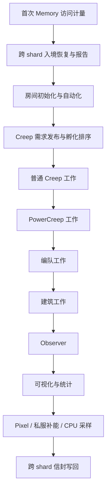

# 项目逻辑与架构

## 全局运行流程

`src/main.ts` 是组合入口。模块加载时启用 BetterMove、RoomResource 并调用一次 `mountWork()`，将房间、角色和建筑适配方法挂载到 Screeps 原型，以及把控制台方法挂到 global。随后建立有名字的 tick 阶段，由 `ErrorMapper.wrapLoop()` 包装。



顺序是依赖关系：先初始化所有可见房间，再使用 Room getter、需求与补给任务；普通 Creep 获取和搬运资源后，建筑执行孵化、反应、能量转移和 Power 处理。前置阶段失败会停止当前 tick，并保留错误给 ErrorMapper；角色和编队内单个单位失败会打印单位信息并继续其他单位。

| 阶段 | 主要输入 | 主要结果 |
| --- | --- | --- |
| memory | 原生 Memory | 触发首次解析，只将成本单独归因，不写持久数据 |
| shards | Observer、Portal 情报、InterShardMemory、跨 shard 任务、入境 Creep | 预约观察、共享目录、推进探门/路由/侦察验证、恢复完整 Memory、更新状态及租约 |
| rooms | Game.rooms、Game.flags、房间 Memory、策略配置 | 补齐内存与缓存、布局工地、实验室配置、发货任务、防御状态 |
| population | 房间资源、Source、旗帜、敌人、现存 Creep、跨 shard 租约 | 重建 `creepConfig`，发布援建/运能需求，生成 `creepSpawnQueue` |
| creeps | 角色注册表、CreepMemory、房间任务 | prepare → source/target、治疗支援 |
| powerCreeps | PowerCreep、房间 Power 状态 | 出生/续命、OPS 管理、Power 技能 |
| teams | `teamConfig`、队伍旗帜、成员 | 编队准备、移动与战斗 |
| structures | 原型扩展、孵化与补给任务 | 孵化、攻击、反应、Link 转移、Power 处理 |
| observers | Portal 发现与共享预约 | 同 tick 幂等调用发现流程；BetterMove 通过同一预约服务安排寻路观察 |
| visuals / stats | 当前 Game 与房间资源 | visual 与 `Memory.stats` |
| maintenance | CPU bucket、shard、市场和运行策略 | Pixel、私服购买、global CPU 采样窗口 |
| shardFlush | 变更后的本地信封、确认回执 | 保留其它命名空间，仅有变更时写回；入 Portal 前还会先单独持久化 |

## 代码职责

```text
src/
  main.ts                组合入口与 tick 顺序
  runtime/               tick 调度、环境维护
    profiling.ts         最近 100 tick CPU 环形窗口、模块聚合与定期日志
    creepIndex.ts        当 tick 的 processer 房间索引，资源量仍实时读取
    observerScheduling.ts 每 Observer 每 tick 的观察预约，Portal/寻路共用
  room/                  房间业务服务
    initialization.ts    全局/房间内存、缓存、建筑初始化和签名
    flags.ts             位置与建筑配置旗帜
    layout.ts            中心候选预览与自动布局兼容入口
    labs.ts              反应选择、boost 需求与 Lab 分配
    terminal.ts          发货任务、能量与中央库存平衡
    market.ts            出售订单选择与配置清单执行
    defense.ts           安全模式、敌人目标、战争状态、维修
  planning/              持久布局、规划算法和增量建设
    automaticLayout.ts   首次规划/快照、CPU 调度、失败重试、巡检
    blueprint.ts         当前布局快照、规划结果转换、经理/Lab 元数据
    construction.ts      RCL 配额、叠加合法性、工地预算、缺失建筑补建
    controllerContainer.ts  三格容器的内侧升级位、外侧搬运位选址
    controllerContainerMigration.ts  发展期旧蓝图的局部迁移与运输路径验证
    exitPerimeter.ts      原生合法出口防线、八方向端点封闭与校验
    exitTowers.ts         入口安全塔位、覆盖火力、建设顺序与供能道路
    resourceDistances.ts  资源工作位距离评分，单次 BFS 比较基地候选
    layoutStrategyMigration.ts  旧规划的版本升级与未开建布局迁移
    types.ts             可序列化绝对坐标蓝图和进度协议
    planner63.ts         63bot 算法的受控适配入口
    vendor/              原布局算法与本地网格/并查集/二叉堆
  shard/                 控制台扩张任务、行程和跨 shard 通信
    controller.ts        任务校验/状态、源房派工租约、目的地报告
    missions.ts          任务/单位/租约类型与业务数据校验
    state.ts             实际送达量的持久化，避免角色与控制器循环依赖
    workers.ts           claimer、采建工、单程/往返运能工的状态机
    types.ts             Portal hop 与版本化信封协议
    portalTypes.ts       有时效的 Portal 目录与本地观察进度
    portalIntel.ts       Observer 扫描、目录失效、跨 shard 情报共享
    routePlanner.ts      基于真实入口/落点的有向图路由与地图验证
    routing.ts           任务等待/重试和在途单位剩余路线重规划
    explorationControl.ts 探门代际、独立租约及报告接收，完整路线前只派探索单位
    explorationRoutes.ts 下一 shard 搜索优先级、真实部分行程和有界本地交叉房选择
    exploration.ts       无自有房/Observer 时以单位视野探门并共享进展
    verification.ts      源端候选版本、证明校验与工作派工门槛
    scouting.ts          单 MOVE 侦察兵的现场检查和去返验证
    scoutProof.ts        独立证明目录、容量保护与持久化事务
    travel.ts            真实 Portal 校验、精确进门、逐跳推进
    transport.ts         namespace、Memory 快照、恢复/确认、TTL/容量
  creep/                 需求与执行分离
    demand.ts            兼容名称生成、需求写入、战争角色限制
    basePopulation.ts    基础运营需求
    remotePopulation.ts  外矿与旗帜任务需求
    warPopulation.ts     防御与双人队需求
    threats.ts           敌人连通分组
    spawnQueue.ts        正常及紧急孵化优先级
    population.ts        需求刷新编排、死亡 Memory 清理
    execution.ts         角色与编队执行、单位故障隔离
  module/                兼容入口、建筑/可视化/Observer 控制器
  role/                  各角色行为工厂及共享塔支援
  squard/                编队行为，保留原目录名
  mount/                 Screeps 原型适配层，调用游戏 API
  settings/              策略、模板、布局和协议配置
  interface/             Screeps 全局接口及 Memory 类型扩展
  utils/                 移动、资源显示、战斗计算、矩阵、错误映射等
```

依赖方向以组合入口 → 业务服务 → 角色/游戏适配 → 工具/配置为主。新增领域逻辑放在 `room/` 或 `creep/`，原型扩展保留对游戏对象的短操作；尽量避免再把多种策略合并到一个 Controller。原有环境通过全局 Game、Memory 和原型适配运行，本次保留该契约；测试使用隔离加载器提供这些对象。

## 状态与生命周期

| 状态 | 生命周期 | 规则 |
| --- | --- | --- |
| Game | 当前 tick，由游戏提供 | 不把游戏对象当作长期持久状态 |
| Memory.creeps | 跨 tick | 保留角色工作状态；每 tick 清理已死亡单位 |
| RoomMemory | 跨 tick | 孵化配置、任务、实验室、位置、目标库存和编队配置 |
| `roomBlueprint` | 跨 tick，首次成功后保存 | 完整规划或现有 RCL8 布局快照；巡检不重新覆盖 |
| `roomBlueprintState` | 跨 tick | 首次拥有时间、规划重试、补建巡检等级与错误原因 |
| `shardMissions` | 起点 shard 跨 tick | 控制台任务、目标进度、单位租约及代数、探门进展、路线版本和侦察验证状态 |
| `shardArrivals` | 中间/目标 shard 跨 tick | 到达任务、实际送达总量；无人更新且超 TTL 后清理 |
| Portal 情报 | 本地 Memory 与 InterShardMemory | 门坐标/落点/观察时间；本地临时门用本地 decay tick，远端仅共享稳定门 |
| InterShardMemory 信封 | 各 shard 独立持久字符串 | `ecbotShard` 命名空间、迁移快照/ack/控制消息/报告、独立 `explorationReports` 与 `scoutProofs`，毫秒 TTL |
| `creepConfig` | 每次需求刷新重建，默认 5 tick | 不合并旧需求；名称和优先级决定后续孵化 |
| `creepSpawnQueue` | 沿用直到刷新 | 孵化成功后移除队首；过期或已有单位的条目安全跳过 |
| `boostNeed` | 当 tick 派生数据 | 初始化清空，在 Lab 更新周期重算 |
| global 房间缓存 | VM reset 后重新生成 | `structureIdList`、路径/矩阵等；不是持久事实来源 |
| 房间实例私有缓存 | 游戏对象生命周期 | getter 避免重复查询同一个 tick 的结构和资源 |
| CPU 历史 | global 采样窗口 | reset 后重新开始，不写入持久 Memory |
| CPU 阶段聚合 | 当前 VM 的有界 Map + 环形窗口 | 默认采集最近 100 tick，定期日志/主动查询时排序；reset 后重新预热 |

初始化只补缺字段，保留旧位置、队列、任务和实验室配置引用。所有可见房间先初始化，避免房间 A 的跨房间任务访问尚未准备的房间 B。缓存刷新会清理指定房间路径和结构缓存，保留业务 Memory。

建筑和工地 getter 使用本 tick 的 `find` 结果，类型 getter 共享房间结构列表并缓存于当 tick 的 Room 实例。跨 tick 的全局 ID 只记录结果，不能让空数组遮蔽新建 Spawn/Lab；工地仅包含自有工地，完工后的新建筑在下一 tick 可见。

## 房间自动化

初始化所有房间后，统一处理一次全局配置旗帜；先为所有非撤离房间更新 boost、Lab 反应及 Factory 生产预留，再逐房执行：安全模式 → 中心候选可视化 → 建筑布局 → 终端平衡 → 市场出售 → 建筑补给初始化 → 敌人识别 → 维修 → 签名。这样任何供给房发送资源前都能看到其他房间的生产预留。防御矩阵由实际使用者按需生成。

布局入口调用 `planning/automaticLayout.ts`。首次见到 RCL8 且未保存蓝图时，直接记录当前建筑与自有工地；其他自有房在 CPU 允许时调用 `planner63`。规划成功才持久化，失败或 CPU 超预算留下原因并冷却重试，每 tick 只尝试一个房间。保存后消费蓝图创建缺失工地，升级立即检查新增配额，降级不拆已有建筑。

成熟稳态巡检按房名错峰；和平 RCL8 且 bucket＜1000 时采用 100 tick 周期，正常为 10 tick。新房、首次保存蓝图、等级变化、强制命令和最后 Spawn 丢失保留即时执行。首次错峰可提前对齐相位，漏 tick 后仍以最大间隔兜底，bucket 恢复时返回正常周期。

新规划在完整建筑落位后选择距 Controller 恰好 3 格的容器，检查至少两个内侧升级位和一个外侧搬运位，道路连接外侧席位。`controllerContainer` 坐标随蓝图持久化；RCL1–7 旧 `planner63` 蓝图按 CPU 预算和冷却做一次局部修正，先确认运输路径，再取消零进度自有旧工地。既有建筑和已投入建设进度的工地保留，源/矿容器、原 Controller Link、RCL8 和 snapshot 蓝图不迁移；迁移推迟或失败时不补建过近的旧控制器容器，其余建设继续。

63bot 算法源自工作区 `63bot/default/manager_planner.js`，保留分区、基地选择、Lab 模型、防线和道路规划，算法状态改为函数局部变量。队列原 WASM 依赖换成本地二叉堆，网格/并查集独立封装；不引入 63bot 的全局初始化、原型或旗帜控制器。`planner63` 验证 controller/mineral/source 参数、整数坐标和规划结果，CPU 预算异常在调度层隔离，所有退出路径清理临时数据。

单边出口或总出口格数不超过 32 的房间优先封住入口。`exitPerimeter` 从边界沿八方向搜索到第一批原生允许建 Rampart 的格子，端点随地形回折，校验整条防线无斜向绕行；防线超过 80 格、资源格冲突或核心无法保护时退回原有防线。出口 y0/49、x0/49 以及贴着可通行出口的 y1/48、x1/48 均按原生建造限制排除。适用房间在同一次规划中按 Source、Controller、Mineral 的实际地形步行距离选基地，默认权重为 3、2、0.5；明确指定或已有 Storage 的锚点优先。多边宽出口继续使用原有分区及围墙策略，以上阈值在 `settings/construction.ts` 配置。

出口防线适用房间由 `exitTowers` 在敌方可站位以外至少 4 格处选 Tower，射程按 Chebyshev 距离计算，天然墙不遮挡远程攻击。塔位优先提高入口最弱位置的合计基础火力，并兼顾分散覆盖和供能道路；Tower 在 5 格内伤害为 600，之后每格减少 30，20 格及以上为 150。候选不能覆盖资源、建筑、运输道路或防线，新增道路在内区接入已有网络；没有足够合法位置或可达道路时保留原塔位。建设顺序还按每个塔数量前缀的入口火力排序，使 RCL3/5/7 先建的少量 Tower 也能覆盖入口。距离安全以完整的入口防线为前提；策略在 `exitDefense.towers` 配置。

蓝图保存 `planningStrategyVersion`；旧 RCL1–7 的 planner63 蓝图共用首次规划的 CPU、单 tick 房数和重试预算升级一次。尚未有策略版本的 RCL1–3 房间，没有已有建筑且所有自有工地均属于旧蓝图、进度为零时允许重新选基地，在新蓝图完整验证后取消不兼容的零进度工地。已有出口布局的版本 1→2 升级保留基地，仅更新出口防线、尚未开建的 Tower 和必要道路。已有建筑、已投入进度和后来人工添加的 Rampart/Tower 保留；只取消旧蓝图中零进度且已淘汰的工地。人工设置的经理站位、RCL8 与 snapshot 蓝图保持原有规则。几何分析、物流评分、vendor 规划、塔位优化与适配校验共用整次调用的 CPU 上限。

蓝图采用绝对坐标，不依赖中心偏移模板。已有建筑坐标优先合并，施工仅检查实际存在的结构/工地，不拆迁。建设层分别维护当前 RCL 类型限额、每房活跃/新建工地限额和全局预算；成功 `createConstructionSite` 意图会在当前 tick 自行记账，避免 `find` 或 `Game.constructionSites` 尚未更新时重复创建、突破上限。允许 road/container 和 rampart 的合法叠加；已有异类建筑和任何同格工地会阻挡目标。道路和 Rampart 分阶段开始，矿物 Container 等到 RCL6，Extractor 只能放在矿物格。

63bot 的 Storage 坐标旁一格是经理站位，适配层将其写入尚未设置的 `managerPos`/`centerPos`。规划中的两个底物 Lab 实际建成且几何范围符合反应要求后填入缺失配置；仍有效的人工 Lab/位置配置优先。RCL8 快照保留已有配置，不猜测人工基地的站位。

终端以 `room/resourceNetwork.ts` 的全房库存和队列索引规划；启用 Power 且实际 Storage 容量至少 8M 的房间自动成为仓库。普通房补齐全套 T3、基础矿、G 和 OPS，余量按每种资源的仓库库存分配，再平衡仓库之间的差异。每 30 tick 全局规划一次，发送、冷却和终端备货每 tick 处理。库存、批次及兼容边界见 [资源调度与生产](resources.md)。自动策略不依赖 `Memory.centerStorage`。

Lab 优先本房不足 20000 的 T3，否则选择全局库存最低且可合成的 T3；稳定批次默认 3000，计入其他房间在产数量，复用本房和仓库现有 T1/T2，只递归合成真正缺少的前置。普通房基础矿/G 保留 10000，Boost 和 Factory 所需原料互相隔离。Lab 原型和 Processer 负责装填、清空和反应，切换配方时停止旧反应并清理旧补给任务。Factory 优先原料足够、等级和 Power 效果合法的商品，否则压缩本房开采矿物；Manager 与 Processer 搬运原料和成品，商品及压缩矿余量统一调到仓库。

同 tick 同房的反应底物对象只解析一次，缓存以 Room 弱引用、tick、shard 和两个底物 ID 为边界；输出 Lab 的冷却、矿物及反应意图独立处理，缺失底物安全退出。没有已接受的出生强化预留时，不创建重复单位名单；预留去重和 excludePlan 仍立即生效。

非 NPC 的有效攻击部件触发战争模式。战争默认暂停全帝国中不在 `warModeRole` 的角色，孵化需求则按房间战争状态过滤。敌人扫描默认每 tick，仍可通过 `roomPolicy` 调整非战时频率。安全模式在关键仓储/唯一 Spawn 受损且可激活时开启。

道路微伤阈值结合原最小损伤与维修塔距离对应的原生维修量，危急道路绕过批处理。和平自有 RCL8 在低 bucket 时每 10 tick 错峰巡检完整道路列表，跨 tick 仅保存达到维修条件的道路 ID/扫描时间/最近敌情；待修道路的血量、存在和归属房每 tick 重新读取，其他建筑照常检查。微伤不进入每 tick ID 列表；新达阈值或危急道路允许最多 10 tick 的发现延迟。敌情及离开后一个巡检周期、bucket 恢复、RCL1–7 时恢复完整扫描。shard 切换、时钟回退及失去房间视野会清理 ID 缓存。

## Creep 需求与执行

基础需求根据 Source、Container、Storage、建设和维修状态发布；远程需求由旗帜和外房视野发布；战争需求根据攻击力、敌人分组和队伍旗帜发布。`addCreepConfig()` 统一生成原有 `ROLE_SHA1(displayName)` 名称、填充 CreepMemory，并检查角色是否支持及战争限制。

起建需求由 `populationPolicy.bootstrap` 控制：没有 Spawn 的自有房有工地时，从距离范围内最近且非战争、能支付最小 worker 的房间孵化 `bootstrap rBuilder`。它跳过 Lab 强化、用 Source ID 导航、自采能，并优先第一个 Spawn；已有 Spawn 但尚无 Source Container/Storage 的房间发布本地自采能 builder。正常远程 builder 仍保留原大身体/强化策略，成熟房 builder 继续使用物流。每次人口刷新重建需求，目标出现 Spawn 后自动停止发布支援替补；CLAIM 成功后停止重复占领及续派 claimer，旗帜保留。

普通队列按 `spawnPriority` 升序排列，过滤已存在 Creep 和不支持的角色。紧急规则仍保持：没有 Harvester 时先补 Harvester；有 Harvester、无 Filler 且 Container 有能量时，先补第一个有能量 Container 的 Filler。Spawn 从身体模板选择可支付的组合：基础恢复角色按当前可用能量，其他角色按房间能量容量选择并等待能量充足。

角色工厂接收 `memory.data`，返回 `ICreepConfig`。执行器每个 tick 每个单位创建一次行为对象，执行 `prepare()`；准备成功后根据 `memory.working` 选择 `source()` 或 `target()`。工作阶段切换由角色更新 Memory，执行器不根据布尔返回值自动切换。`isNeed()` 在对应需求发布逻辑中使用，并不是所有旗帜需求的统一拦截器。

| 角色组 | 角色与职责 |
| --- | --- |
| 基础采集/搬运 | harvester 采集 Source；filler 补给建筑；miner 采矿物 |
| 基础工作 | upgrader 升级；builder 建设；repairer 维修；scout 巡视外房或旗帜 |
| 房间物流 | manager 中央定点搬运；processer 处理 Lab/终端/Power 等资源任务 |
| 扩张/外矿 | claimer 占领；reserver 预定；rHarvester 远程采集；rFiller 搬运；rBuilder 远程建设/维修 |
| 跨 shard | sScout 探门或实地验证路线及现场；sClaimer 开房；sBuilder 目标自采能建设/升级；sHauler 装载、逐跳送达与返程 |
| 战争 | attacker 近战；healer 治疗；cAttacker 攻击控制器；dismantler 拆除；integrate 综合战斗；defender / rdefender 防御 |
| Power | 独立 PowerCreep 生命周期、OPS 和技能管理 |

`rAttacker` 的原实现仍未提供，注册表明确拒绝执行和入队。`quad` 和 Factory 工作控制保留原占位行为。Observer 控制器消费 Portal 扫描调度；首个 shards 阶段提前预约观察，后部 observers 阶段调用幂等，不重复发观察意图。

`creep/development.ts` 是 RCL1–7 发展策略的统一门槛：自有 Controller、全局开关与房间 `fastUpgrade`；RCL8 直接走原 `basePopulation` 分支。`developmentPopulation.ts` 优先发布本地采矿与运输，普通源默认未强化配额在 550 容量时合并为 4 WORK + 1 WORK，在 700 时由单只 5 WORK 覆盖。配额依据再生容量，Source 暂时枯竭不撤需求；收入只计实际到矿位且完成必要强化的有效 WORK，队列、孵化或赴位中的身体不当作现有收入。

消费预算取在岗产量与活搬运容量/往返运距的较小值；自动外矿还检查选择名单、有效安全情报及真实配套搬运。运输可消化的矿点积压、控制器缓冲超出保留量的库存及有限 Storage 余量可补预算。在位援建工的升级 WORK 和供能席位占用先扣除，本地升级工按实际 WORK 补缺；`upgrading.maximumCreeps = 8` 为上限，还受静态合法席位数量约束，满站时腾出扩容位置替换旧小身体。建造 WORK 另受剩余收入与 BUILD_POWER 限制。

`developmentBodies.ts` 只解析显式发展需求，保留可支付身体与紧急采运恢复。`developmentEconomy.getDevelopmentSpawnReserve` 被人口预算和默认/自定义身体共同使用：控制器缓冲库存至少 300 时升级工额外出生预留为 0，可在配额内扩大单体；否则保留启动余量，孵化仍检查实际可用能量。上述发展预算与身体预留在 RCL8 退出，不改变满级人口、自动外矿发布或 Link 策略。

`developmentLogistics.ts` 每 tick 缓存真实 Controller 缓冲建筑，分配同时满足取能与升级距离的站位。`controllerUpgradeSeatCount` 只统计地形、天然对象及建筑约束下的静态容量，不把临时占用当作永久减容；实际分配检查占用并共用本 tick 预约。当前合法席位优先于内侧偏好，到岗才设置防对穿保护，赴位单位不锁住脚下位置。源矿工同样优先保持可采卸席位；缓冲已满时，有 CARRY 的矿工保留背包批次，背包满则停采；零 CARRY 仅在源容器本格直接采集，满容器暂停。基础角色与 Link 的发展分支仍受统一门槛控制，保留布局坐标和支援任务协议。

本地矿点运输需求在 `FillerData.mineId` 保存固定 Source 身份，`sourceId` 表示当前 Source 或源容器端点。容器建成、更换和暂时空仓不会把该矿的运输配额永久改绑到另一处库存；旧单位可从当期需求恢复矿点。装载进展记录在 `CreepMemory.developmentHauler`，实际取能目标与固定矿点分开保存。`node scripts/hauler-diagnostics.cjs shard1 E39N5` 通过只读 Memory 和房间对象快照展示活运工的载荷、工作阶段、矿点分配及相应需求，并列出各矿、容器和掉落能量，便于核对实际覆盖。

`developmentHauling.ts` 只在发展期运行，候选资源限于指定矿点邻近的能量和容器/Link。先比较实际可装载数量，同量时优先处理矿点地面能量，避免附近碎片抢占完整载荷。原生取能成功后仅在 RAM 预约本 tick 的数量，不修改 Store 或提前进入运送状态；后续 tick 根据实际 Store 满载切换。运送保持至空载，矿点无可取批次且取能停滞达到配置期限后才送出部分载荷。Spawn 应急补给保留最低有效批次。固定库存搬运与没有绑定的旧单位可寻找备用库存，但不写回永久分配；RCL8 不读取此模块的状态。

2026-10-02 官服 shard1/E39N5 验证：修复前右侧源容器 2000/2000，地面约 5000 能量，容量 200–250 的活运工却携带 2–16 能量返程；修复后 tick 74079474，右矿三名运工以 250/250、200/200、250/250 运送，首轮现场观察中右侧地面从 5025 降至 4410，控制器容器从 864 升至 1578。150 秒、8 次只读快照未见角色错误。该差额包含采矿产出与自然衰减，不当作纯运输统计。980 项全量测试、类型检查与构建通过；官服 default 回读 main SHA-256 为 `20ce8bbbf0a2a43b418fea4f5254674efba49962f585c816c98d450b38e58a75`。

`role/support/builderEnergy.ts` 为本地远程援建及跨 shard 建造工提供同一套取能状态机。足量掉落、容器、主库存和 Source 都检查原生动作及移动结果；失败或持续无进展的目标短期排除，所有层级共用每 tick 候选预算。碎屑仅在可靠库存不可用时回收，已有部分载荷的装载等待不会被小额入账或换目标重置，避免 800 容量援建工在矿旁一直攒包。状态保存在 `CreepMemory.aidBuilderEnergy`，旧单位可直接接管，强化/Portal/任务协议不变。

`role/support/builderWorkPosition.ts` 处理援建无工地升级及控制器应急维护：能原地升级就保持当前位，需要赴位时保留目标、共享供能席位预约，并禁止移动时对穿其他工人。相邻真实缓冲可同时发 WORK 升级与 CARRY 取能意图；空载只取能，下一 tick 根据真实 Store 恢复升级，不为补能搬动合法远席。进入施工、装载或转运分支时释放旧升级保护；有工地仍使用原取能优先序。施工保护由 `shard/workers.ts` 与发展期 `RoleBaseBuilder` 分别维护：成功建造后保留合法施工位的 `dontPullMe`，赴工地使用 `ignoreCreeps: false` 避让占用，取能、空载或切换维修时释放保护，避免援建工与本地建造工反复交换工作位。

`developmentRemotes.ts` 在人工任务发布后选择普通邻房，按受限 CPU 预算侦察真实路径，保存 Source 坐标、往返耗时、产量和安全期限。人工 `_OUT` 占优先名额，战争和危险会阻止新配置；自动单位通过执行入口的专用 wrapper 检查状态并撤离，人工角色仍使用原行为。执行器允许自动外矿在战争时进入 prepare 完成撤离；wrapper 不调用原远程角色的强化流程。

`developmentRetirement.ts` 只处理显式标记的发展单位。合并矿工时，旧工等已发布接班者完成必要强化、到源旁默认两格内，且其有效 WORK 覆盖本轮发布可实现的配额后才交班，避免以尚不可孵化的目标或未到岗身体提前撤产。需求缩减时回收多余消费单位；离开发展阶段后先等待正常采矿、运输接班再回收相应单位。Spawn 跳过 RCL8 刷新间隔内残留的旧发展需求；RCL8 新配置没有发展标记，老满级单位不受退役处理。参数入口为 `settings/development.ts` 和 `settings/developmentRemotes.ts`；关门槛可恢复单房原策略，不改人工外矿。

2026-10-02 后续官服发展验证：shard1/E39N5 已到 RCL3、容量仍为 550。tick 74080136–74080202 的 300 秒观察中，近源接班的 4 WORK 与原 1 WORK 工正常采矿，两只旧 2 WORK 工已离开矿位归还能源、进入回收流程；两只新 4 WORK 升级工已到供能席位，末次原生升级事件的 `energySpent` 合计由首样 8 提升至 14。15 组房间/单位快照无角色错误；源边地面存量曾降至 0，受采集、运输和衰减共同影响，不作纯运输统计。施工及升级席位保持、空载释放、单开采位交班和零 CARRY 边界有回归覆盖；1021 项全量测试、类型检查、构建通过。最终官服 default 回读 main SHA-256 为 `d619387cef4fd3544ccf2fcd3ec84a283099af719d304975a3b3e250114bb751`；其后 90 秒的 5 组快照仍无角色错误，升级耗能为 12/tick，另一只新 4 WORK 工正在赴位，旧矿工已归还背包能源并继续回收。同期 shard3 的 45 秒观察无角色错误或 CPU 超时报错，3 个采样总 CPU 为 16.2–19.9，11 个房间的成熟人口仍运行。

## 跨 shard 状态机

`shardTask(sourceRoom, "targetShard/targetRoom", options?)` 在起点生成带 `${sourceShard}:${id}` 唯一键的任务，id 可自动生成。对象形式 route 可省略；传入手写 route 时仍校验 Portal 链连续性。创建检查不同 shard 的目标、自有 Spawn、人数/库存及 claimer 身体容量。自动任务在 `routing` 保存 ready/waiting 和下次重试时间；没有去程或所需返程时不创建新的派工槽位，清除尚未孵化的旧需求。

`portalIntel` 先收集可视房间实际 Portal，再定期预约 Observer 覆盖内的高速路交叉房及过期观察点；私服可配置额外扫描扇区中心。范围、bucket、扫描量和容量有界；observeRoom 的下一 tick 视野才成为事实。`observerScheduling` 只在成功预约后标记当 tick 占用，BetterMove 与扫描共用，避免晚调用覆盖同一建筑的意图。每 shard 独立分享稳定门目录，远端目录按墙钟有效期过滤；本地临时门仅以本地 tick 计算剩余寿命。没有 Observer 的 shard 仍可消费其他 shard 及单位视野的情报。

自动任务默认启用 `explorePortals`。完整去程或所需返程未知时，`explorationControl` 使用独立 `explorer:0` 槽位发布单 MOVE 的 `sScout`；探索数据在 `data.exploration`，与验证用 `data.scouting` 分离。`planExplorationEntry` 只预选最近可达的真实下一跳入口；`explorationRoutes` 根据配置连接优先级选择下一 shard，在当前 shard 原生地图比较当前位置到入口的路径长度，忽略落点及终点成本。单位跨越后从真实落地点重新选择下一座门；`selectedPortalHop` 固定当前段，旧单位未走的自动前缀会清理并重新择近，显式手写去程保留。没有真实入口时才走访当前最近可达高速路交叉房。连接表不产生虚构坐标或迁移意图，进门仍要求真实 Portal 和持久化快照。

探索行为只使用实际房间视野，逐房收集、共享门目录；有返程目标时继续探索反向入口。`searchOrigin` 限定本轮候选范围，新目标按单位当前房间到未访高速路十字路口的原生路径长度排序，直线距离及房名用于稳定同距次序；原生查询也先检查当前位置较近的候选，`nearestOnly` 利用剩余候选的曼哈顿下界在最近目标已确定时停止追加查询。已选 `searchTarget` 在途中保持稳定，抵达、无路、超时或被其他视野扫描后再择近探索，不从最初落地房间排序造成折返。Portal 扫描开启时，当 tick 可见十字路口也计入已扫描房，避免重复走访；真实 Portal 选择不受已访房过滤影响。`scoutMovementOptions` 为单 MOVE `sScout` 提供统一地形成本，BetterMove 的 `ignoreSwamps` 缓存标识将这类路径与普通工作单位分开。报告存于独立 `explorationReports[missionId]`，源端校验单位身份、代际、位置及墙钟时效，并以共享 Portal 目录重新规划。完整路线 ready 后撤回探索需求，另派完整行程验证侦察兵；探索完成报告不等于 verified。候选数、已访房、原生查询、CPU、寿命、房间超时和失败重试均由 `portalExploration` 限制，缺门和不可达区域不触发无限搜索。

中间 shard 可以没有自有房、Spawn 和 Observer，但所有行程涉及的 shard 都须运行同一版本脚本并分配 CPU，入境恢复、单位移动和情报共享才能继续。`explorePortals: false` 或全局 `portalExploration.enabled: false` 会让未知路线等待现有观察情报；固定手写路线默认关闭主动探门。

`routePlanner` 把入口及落地房间组成有向图；去返分别规划。`portalRouting.strategy` 默认 `nearestHop`：根据尚未经过的 shard 连通关系选择下一跨越，再只比较该段到入口的距离，逐跳以实际落地房间推进；直达门不可达时尝试可达中转链。最终落点至终点若可在当前 shard 验证，只据可达性过滤，不把距离加入选门排序。完整路线的总费用保留作统计。可选 `totalCost` 保留以全程费用做有界 Dijkstra 的策略。仅当前 shard 的房间路径调用 Game.map 验证，避开禁行与非普通区域；远端费用按坐标估算，避免误用本 shard 地图。节点、跳数、原生路径调用和重试周期可配置，同 tick 共享查询结果。已就绪任务通过含策略的拓扑签名判断选门规则、门的新增、移除和目的地变化，再重算候选路径；规划尚未成功时保留旧签名继续重试，观察时间刷新不触发重复寻路。路线变化仍使验证版本失效，验证 scout 严格走源端候选快照并提供精确证明。`routing` 在门失效时从单位当前 shard/房间规划剩余行程，并清理旧的 transferPrepared 标记，保留 cargo、pendingDelivery 和单位身份。入口无路可达时仅对该单位临时避开入口，并退避重试，不删除仍真实存在的门。

自动路线默认启用 `verifyRoute`，固定路线默认关闭，也可由任务显式设置。路线就绪后，需求层先使用独立 `scout:0` 槽位孵化 `sScout`，身体只有一个 MOVE；其行为只移动和报告，不领取建设或物流任务。侦察兵实际到达目标 shard 的目标房间才提交去程证明，有返程时实际回到源 shard 的源房间再提交返程证明。证明必须成功写入并持久化后才能切换行程或完成，通信写失败时停留并重试。

侦察证明存于信封独立的 `scoutProofs[missionId + ':' + leg]`，包含任务所有者、侦察兵身份、路线版本、方向、完整路线、实际 shard/房间、墙钟时间和行程 tick 数。源端核对当前租约身份及创建时间、精确路线和实际终点，只接受同版本、有效期内的证明；去返所需证明齐全后 `mission.scouting.status` 才变为 verified 并允许工作单位派工。路线变化、失败、死亡或证明 TTL 过期使验证重新进入等待/侦察，失败门按墙钟期限暂避。`routeScouting` 分别限制单段 tick、卡住时长、证明数量/寿命、失败重试和整个侦察等待时长。

实地验证提供当时的连通性与目标现场信息，单 MOVE 的行程耗时不能保证满载 worker、沼泽疲劳和 CLAIM 寿命具有相同表现，也不能代替单位执行时的持续检查。验证开启的单位若需要新的路线，会停止等待重新验证并保留货物、交付意图与身份；显式 `verifyRoute: false` 才直接使用自动重规划结果。

需求刷新通过逻辑槽位与代数创建唯一名称，不因单位从起点 Game.creeps 消失立即重派。源房本地单位、远端状态及 arrival ack 更新租约；自动任务允许已经出发的旧路线或中途重规划产生的同身份入境 ack，避免新计划误判旧单位丢失。确认入境后未存活的单位经宽限期补员，没有任何确认的失联单位等待租约到期。

自动行程只使用实际观察的入口，手动行程消费显式入口。看到实际 Portal 后检查 destination shard/room；邻接入口时先独立写入完整 CreepMemory 快照与下一跳，再至少等待一个出发 shard tick，随后 range:0 进门。目标 shard 在人口清理和角色执行前恢复缺少 role 的单位，清除出发 shard 的准备标记，以推进后的 hopIndex 继续路线。普通已有角色不被远端覆盖，快照不依赖起点 Memory.creeps 的 GC。

CLAIM 完成后的自有房自动进入蓝图规划；sBuilder 在目标采能、捡能或取现有物流，优先 Spawn，并在 Controller 接近降级时先升级。源房收到拥有状态后停派 claimer，目标达到设定等级并有 Spawn 后完成建设目标。只运输任务可关闭 claim/builders。GCL 不足、他人占领/预定或入口变化留下可查询提示，不自动攻击或拆迁。

运能工的状态为 `load → outbound → work → return/load`；没有返程路线则 `work → done` 并在目标回收。取能在 room/store 两层记录成功意图，多个运输工不把同一旧 Store 快照的余额重复当作可提取资源；保留库存以运输工的当 tick 取能预算为准，正常房间其它角色仍独立消耗库存。目的地先补自有 Spawn/Extension，后补物流或交给采建工，没有接收者等待而不丢 cargo。transfer 的 OK 仅创建 pendingDelivery，下一 tick 用实际 cargo 减少量累计送达；失败意图或容量竞争不虚增任务进度。

往返时临时 `originShard` 指当前行程起点，`task.sourceShard` 始终指任务所有者，两者不混用。完成/取消阻止起点开始下一轮运输；暂停/取消清除待孵化需求并通过源端小型 command 阻止目标 claim，在途货物及已拥有房的建设可完成收尾。任务完成要求建设目标和有限运输量均达成；energyAmount=0 的运输持续运行。

通信通过 `InterShardMemory` 保存版本化 `ecbotShard` namespace，同时保留其它根字段。远端字符串按 peer/tick 缓存；坏 JSON、未知版本或错误字段形状不会覆盖原数据；超 UTF-8 容量、未确认信封达到上限或写入失败时停止进门。TTL 使用 Date.now 毫秒，只有出发门前一 tick 等待使用当地 Game.time。放弃路线会撤销该单位的本地待迁移快照；入境候选在所有 peer 间按新旧排序，避免其他 peer 残留的旧行程因枚举顺序覆盖新行程。ack 身份包含单位/任务/跳数和代数时间，避免同名替补及往返旧 ack 混用；报告按任务单遍分组，按周期发送，命令不重复附带整份任务。

## 性能优化与测量

`TickRunner` 默认用 `Game.cpu.getUsed()` 采集全部主循环阶段差值，并在 finally 中按周期输出报告；出错阶段也记录并继续抛原异常，统计/日志失败不会覆盖原业务异常。`runtimePolicy.profiling` 配置最近 100 tick 窗口和每 100 tick 报告，首份报告等待窗口预热完成。每模块用有界环形数组记录单 tick 汇总值并增量更新总量，同 tick 多次调用合计，空闲 tick 计 0；窗口不足 100 tick 时用统一的实际覆盖 tick 数作分母。

`rollingAverage`、`rollingTotal`、`rollingMax` 和 `current` 分别表示窗口均值、窗口总量、单 tick 峰值和当前 tick 消耗；原有 EMA/count/total/max/average 累计字段继续保留。主阶段用 `tick:*`，房间业务用 `room:*`，跨 shard 发现/恢复/规划用 `shard:*`，角色执行按固定角色名用 `creep:*`，避免使用每个单位名增加目录容量。同 tick 的多房间/多任务/同角色消耗汇总为同一项。细项包含在上层阶段中，日志分组呈现，不能重复相加；VM 初始化和日志输出不计入这些模块。

`sampledTicks` 记录窗口中真正收到该阶段样本的 tick 数，`sampledAverage` 为这些 tick 的合计 CPU 均值；零 CPU 的真实调用也算样本。同 tick 多次调用只增加一次覆盖计数。日志额外显示 `tick:shardFlush` 的末阶段采样覆盖：CPU 硬超时可能让本 tick 尚未结束的阶段及后续阶段完全没有样本，此时 `rollingAverage` 包含缺测 tick 的零值，不能把偏低结果当作优化收益。

仅在定期日志或 `cpuProfile()` 查询时排序，重复采样复用聚合对象而非每次分配新对象；`cpuReset()` 重置数据与预热进度。`logEnabled` 可只关闭自动日志，`logDetails` 控制细项输出，`roleDetails` 控制角色测量；原有逐只 Creep 慢操作提示默认关闭，由 `creepDetails` 单独开启，房间单次提示仍由 `roomPolicy.profiling` 配置。关闭总统计开关时不额外查询 CPU。数据不逐 tick 写 Memory，VM reset 后清空。

`tick:memory` 提前访问 Memory，把首次解析开销从 Portal 发现中分离，不能将这次归因调整当作 CPU 节省。Observer 索引用 ID 每 25 tick 重建，仅使用本 tick 的 Game 对象判断活性；空热点房短期重扫，已知门所在房间仍每 tick 确认，新获得视野立即扫描，状态查询在同 tick 共享。候选按符号房间坐标生成并单遍选择，不改变最近入口和实地验证协议。房间维修懒选首个目标；终端每房保持同周期、按稳定房名错峰并共享本 tick 成员/队列索引，所有库存仍实时读取。详细配置及计数证据见 README，授权只读官服的优化前数据见 [CPU 基线](cpu-baseline.md)。

连续采矿按有效 WORK/boost 产量批量卸载：在下一次采集将使剩余容量不足再一批时转移，源耗尽时卸出最后余量，保持原生 Store 在意图结算前的快照语义。准备与执行共用本 tick 的工作位几何，远处 Link 不查询活性；库存、容器急修和采集仍读当前对象。标准 5WORK/1CARRY 的 20 tick 回归保持采集 200 能量，转移从 20 次降到 5 次；14WORK/2CARRY、混合 boost、身体受损、满缓冲及无站点回退均单独验证。

`runtime/harvestPower` 共享有效产量缓存，按 native ID、健康/受损状态、boost 阶段与寿命身份失效，不持有跨 tick 原生对象；全局 harvest 包装器复用它并按源余量/初始容量估算统计。批量卸载采用单位名字的稳定 phase，安全剩余容量及源耗尽作为兜底，长期转移频率与吞吐保持相同。Lab 补能队列按房间 job tick 只清洗一次且原地去重，保留顺序/数组身份，旧 full/gone 处理继续由 filler 负责。

低 bucket 时仅将和平高血屏障加厚错峰至 5 tick，取能、控制器维护及其他目标保持即时；同 tick 共享临界屏障索引，保证新低血目标抢占旧高血目标。有敌情或战争绕过错峰，bucket 恢复后恢复每 tick 维护。市场自动出售按房间 25 tick phase 扫描，直接出售函数仍即时，中央库存配置继续每 tick 写入。成熟房建设 interval 的早期短路保留升级/强制旗帜/缺 Spawn 时的即时巡检。

和平房间不再周期预热防御矩阵；按需 getter 在实际年龄过期时重建，同 tick 多消费者只生成一次。道路塔修理将轻微损伤合并至 `min(200, hitsMax×5%)`，道路低于或等于一半血量立即修，其他建筑修理及战斗/治疗保护保持即时。实验室配置和终端资源分发共用 `runtime/roomSchedule` 的稳定房名 phase，每房频率不变；boost 需求继续每 tick 汇总。正常房间状态按可配置 100 tick 缓存，异常仅同 tick 缓存，墙钟截止时间提前失效；Portal 实物及过期检查继续即时，扫描历史维护默认每 25 tick 执行，新增或拓扑变化立即整理。

减少的是重复 JS 遍历，原生 Room.find 的同 tick 缓存语义保留：Room 建筑按类型一次分组；processer 按 tick/shard 一次建立房间成员索引且每次读当前 Store；reaction 按本次调用缓存资源量；boost 单遍计数身体；Lab 只有两个底物 Lab 查询原料；终端任务单遍建索引、最低能量房单遍选择；旗帜从每自有房一次变为全局每 tick 一次。规划的全局工地预算延迟到真正巡检时创建，低等级房间不匹配未解锁 Lab，已有有效 Lab 配置按 ID 快速确认。

本地对比的 workload/访问次数记录在 README 和 performance 测试中。已只读采集真实服务器优化前基线；不能将本地访问次数直接写成实服 CPU 节省比例，应部署后分别观察规划首算、常规 tick 与 Portal/大量单位场景。

## 旗帜与控制协议

| 旗帜 | 作用 |
| --- | --- |
| updateCache | 刷新所在房间缓存 |
| managerPos / centerPos | 写入对应房间位置，成功后消费旗帜 |
| repairTower / lab1 / lab2 | 指定塔或原料 Lab；目标未就绪时保留旗帜 |
| planRoomCenter | 展示中心候选；中心位置仍通过 centerPos 设置 |
| planRoomStructure | 即时按保存蓝图补建；无需旗帜也会自动巡检，不覆盖旧布局 |
| layout | 显示所在房间的完整保存蓝图；原版风格建筑图标与道路连接，移房切换，删除关闭 |
| `{room}_SCOUT` / `{room}_OUT{i}` | 指定侦查任务与外矿房，OUT 数量统一配置 |
| `{room}_ATT{i}` / `{room}_INTE{i}` / `{room}_DIS{i}` / `{room}_CA{i}` | 单位攻击、综合战斗、拆除、控制器攻击 |
| `{room}_RF_S{i}` / `_RF_T{i}` | 远程搬运的来源与目标，两个旗帜配对 |
| `{room}_RB_S{i}` / `_RB_T{i}` | 远程 Worker 的来源与目标 |
| `{room}_CLAIM` | 占领目标 |
| `{room}_T2INTE_{i}` / `_T2ATT_{i}` / `_T2DIS_{i}` | 双人综合、近战+治疗、拆除+治疗队伍 |
| nuke | 原有核弹目标，由房间扩展读取 |

更改协议名会影响既有旗帜、成员名字、位置配置和任务；常规调参优先修改数量、周期和阈值。`Memory.centerStorage` 保留给旧控制台人工命令；自动仓库识别、分发与出售使用真实房间状态。

## 扩展步骤

新增角色：在 `interface/creeps.ts` 扩展角色和 data 类型，在 `settings/creep.ts` 配置枚举、身体和优先级，实现角色工厂并加入 `role/index.ts`。然后在对应人口发布器中定义触发需求的条件；把策略阈值放在相应 settings 文件，并增加该角色边界的回归测试。

新增房间服务：单独放在 `room/`，用清晰的输入/输出和 Memory 任务表示需求；在房间编排中放入依赖正确的位置。建筑执行层消费任务，避免让资源调度与单个结构的动作相互混杂。

新增 tick 阶段：在 `main.ts` 的阶段清单中插入 `{ name, run }`，明确依赖前置阶段和失败规则。新增资源出售种类通常只需修改 `roomResourceSales` / `centerResourceSales`，无需复制出售流程。

`utils/BetterMove.ts`、`RoomResource.ts`、`CodeProfiler.ts` 保留第三方实现主体；本次将移动模块公开的调参点迁出到 navigation 配置，未对内部路径缓存与坐标算法整体重写。

BetterMove 的缓存索引指向已发出移动意图的目标格。即使该格是同房路径末端，被 `dontPullMe` 固定站位单位阻挡后也进入临时绕路；实际已经到达无后续步骤的路径时重新规划，避免发送未定义方向。跨房不完整路径在边缘自动传送后仍重新寻路，防止向旧房末格反向移动。可用 `node scripts/development-monitor.cjs shard3 --logistics E31N2` 只读观察物流单位位置与房间供能。

`scripts/` 为 Python/API 辅助工具，不在游戏 tick 主循环中加载。`autoBuyResource.py` 创建/调整/取消采购订单，`defenderCostMatrix.py` 分析出口与外墙缓冲带，`segmentWalls.py` 分析并绘制 Storage 周围可通行区域。TypeScript 防御矩阵由 `utils/CostMatrix.ts` 实时生成，不依赖这些 Python 工具的输出。

辅助工具的默认参数集中在 `scripts/policy.py`：`AUTO_BUY_POLICY` 配置 profile、shard、下单量、价格偏差、价格采样量和各房间库存目标；`DEFENDER_POLICY` 配置 profile/shard/房间列表与外墙缓冲半径；`SEGMENT_POLICY` 配置目标与中心排除半径。房间边长与递归预算有独立命名常量。`client.py` 只在明确调用时读取凭据并创建 API，原有 `./screeps.json` 仍相对当前工作目录；脚本通过 `main()` / `__main__` 执行，导入算法模块不自动读取凭据或发起网络操作。绘图库只在绘图时加载。

`screepsapi.py` 仍是原有 API/WebSocket 封装，未进行协议重写和真实服务连接验证；辅助工具的执行环境和依赖与 Bot 构建独立。

## 验证边界

回归测试覆盖空世界/首次非刷新 tick、旧 Memory 对象保留、主入口顺序、未知角色、工厂/工作阶段异常、战争范围、紧急队列、身体预算、旧队列、连通敌人分组、旗帜保留、安全模式、塔支援、残缺双人队、无视野 PowerCreep、私服成交限制以及 Pixel/CPU 配置。

布局测试覆盖 RCL8 快照冻结/损毁补建、一次规划和冷却、CPU 门槛、升降级配额、跨房及同 tick 意图预算、合法叠加、墙上道路、天然墙矿格 Extractor 的 RCL6 解锁和损毁补建、人工元数据保留和起建派工。规划器还使用开放/不规则地形及官服 shard1/E39N5 的实际地形与资源坐标，在本地寻路模型中运行完整原算法，验证关键建筑数量、合法坐标、资源道路、导入无副作用和 CPU 超预算清理；普通墙格的错误 Extractor 位置仍会被拒绝，模拟寻路与实际 Screeps PathFinder/CPU 仍有环境差异。

`planning/layoutPreview.ts` 在普通房间视觉结束后读取 `layout` 旗帜和已有蓝图；`planning/structureIcons.ts` 用原生 RoomVisual 基元绘制 16 种建筑，样式与预算入口为 `settings/layoutPreview.ts`。预览维护单项 heap 缓存，对坐标和样式计算指纹以兼容 Memory 重新解析及手动修改。重建时保存并恢复同房共享视觉通道，只缓存自身图层；后续 tick 导入缓存，保留其他绘图并检查原生容量。回归覆盖旗帜移删、无蓝图提示、缓存命中与刷新、道路连线、图层顺序、异常恢复和容量边界；没有旗帜时不读取 Memory 或构造 RoomVisual。

跨 shard 回归使用不同当地 tick、同一毫秒时钟和实际模块的两个 shard 模拟，覆盖开房/采建/首 Spawn/完成，以及装载/过门恢复/真实送达/报告完成/返程停止。另覆盖并发取能保留、敌方建筑、暂停取消、首报告前死亡、失联补员、无接收者、完整自定义 Memory、坏 JSON/字段、容量与写失败、往返旧 ack。性能测试用实际访问计数确认索引重建边界、当前 Store 读取、禁用 profiling 的零额外 CPU 查询和聚合容量。

自动路由回归覆盖 Observer 范围与次 tick 视野、观察仲裁、可视门消失和无视野保留、远端稳定目录/TTL、临时门不混用时钟、简写创建、去返路线派工门槛、在途重规划/退避、规划预算、停止任务保留和拓扑变化才重算。主动探门集成从只知第一跳的三个 shard 起步，中间/目标无自有房和 Observer，验证实际移动获得视野、发现去返入口、共享情报、另派验证侦察兵及证明后才放行工作单位。侦察回归核对实际终点、单位身份、路线版本、证明寿命及写入事务，并以真实通信模块模拟双 shard 往返后放行工作单位。图算法测试比较多入口、多 shard、有向返程及本地不可达/绕路；集成移动在房间粒度模拟，不能代表真实地形的耗时。

测试模拟游戏对象，不能替代真实地图、长期库存平衡和实际服务器 CPU 测量。部署仍使用明确的上传命令，本地构建和测试不会连接或修改游戏服务器。
